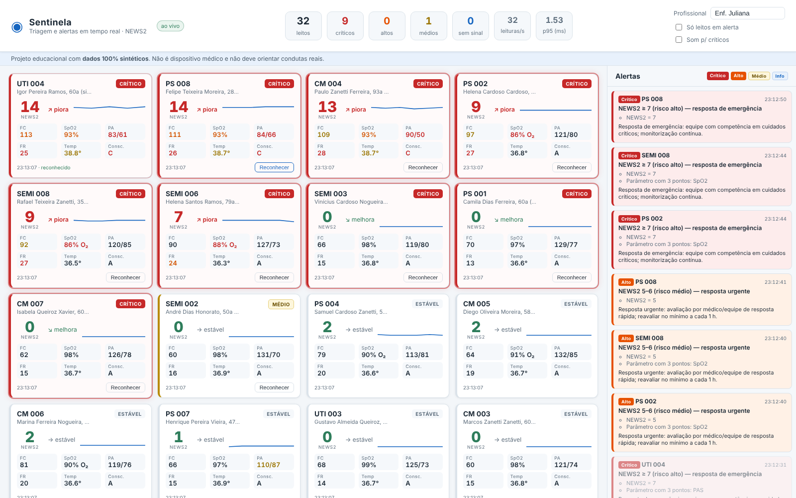

# Sentinela — Motor de Triagem e Alertas Clínicos em Tempo Real

Serviço que recebe um **fluxo contínuo de sinais vitais** por WebSocket, calcula o **NEWS2** a cada leitura,
mantém no **Redis** uma janela temporal de cada paciente para detectar **tendência de piora** e dispara
**alertas priorizados** para um **painel de enfermagem em tempo real**. Inclui simulador de monitores,
**teste de carga com centenas de leitos**, observabilidade (logs JSON, Prometheus, Grafana) e ADRs.



> [!IMPORTANT]
> **Dados 100% sintéticos.** Nenhum dado real de paciente foi usado em nenhuma etapa deste projeto —
> código, testes, logs, capturas de tela ou relatórios. Nomes, idades e séries de sinais vitais são
> gerados em tempo de execução por um gerador determinístico com semente
> ([`sim/synthetic.ts`](sim/synthetic.ts), [`sim/patient-model.ts`](sim/patient-model.ts)); todo paciente
> aparece com o sufixo "(sintético)". Ver [ADR-0005](docs/adr/0005-dados-sinteticos.md).
>
> **Projeto educacional. Não é dispositivo médico** e não deve orientar condutas clínicas.

---

## Sumário

- [Arquitetura](#arquitetura)
- [Como rodar](#como-rodar)
- [Regras clínicas](#regras-clínicas)
- [Teste de carga](#teste-de-carga)
- [Observabilidade](#observabilidade)
- [Protocolo](#protocolo)
- [Decisões de arquitetura (ADRs)](#decisões-de-arquitetura-adrs)
- [Estrutura do projeto](#estrutura-do-projeto)
- [Próximos passos](#próximos-passos)

## Arquitetura

```mermaid
flowchart LR
  subgraph Monitores["Monitores à beira-leito (simulados)"]
    M1[Leito UTI-001] & M2[Leito CM-014] & M3[... centenas]
  end

  subgraph App["Sentinela (Node.js + TypeScript)"]
    GW[Gateway WS<br/>/ws/ingest<br/>validação + backpressure]
    Q[KeyedQueue<br/>fila serial por leito]
    subgraph Dominio["Domínio (funções puras)"]
      N[NEWS2]
      T[Tendência<br/>mediana + regressão]
      P[Política de alertas<br/>confirmação · lembrete · histerese]
    end
    WD[Watchdog<br/>perda de sinal]
    HUB[Hub do painel<br/>/ws/dashboard<br/>lote 1x/s]
    OBS[/metrics · /health/*]
  end

  subgraph Redis
    Z[(ZSET janela<br/>por leito)]
    S[(Estado do leito<br/>+ snapshot)]
    ST[(STREAM<br/>log de alertas)]
    PS{{Pub/Sub}}
  end

  Painel[Painel de enfermagem<br/>navegador]
  Prom[Prometheus] --> Graf[Grafana]

  M1 & M2 & M3 -- vitals --> GW --> Q --> N --> T --> P
  T <--> Z
  P <--> S
  P -- alerta --> ST & PS
  WD --> S
  PS --> HUB --> Painel
  Painel -- reconhecer --> HUB
  GW -- ack + NEWS2 --> M1
  OBS --> Prom
```

**Caminho de uma leitura** (p95 ≈ 1,5 ms dentro do servidor):

1. O gateway valida o JSON (faixas fisiológicas, ACVPU, escala de SpO2) e responde `error` se inválido.
2. A leitura entra na fila **do seu leito** — leituras do mesmo leito nunca são processadas em paralelo.
3. Calcula o **NEWS2** (7 parâmetros, escalas 1 e 2 de SpO2).
4. A cada 5 s a leitura é amostrada para a **janela de 15 min no Redis** (`ZSET`), e a tendência é recalculada.
5. A **política de alertas** decide: escalar (após confirmação), lembrar, silenciar (ack) ou desescalar (com histerese).
6. Estado + snapshot + publicação vão num `MULTI/EXEC`; alertas vão para um `STREAM` (replay) e `Pub/Sub` (tempo real).
7. O monitor recebe `ack` com o escore; o painel recebe o alerta imediatamente e as atualizações de leito em lote.

## Como rodar

### Opção 1 — Docker (stack completa)

```bash
docker compose up -d --build
npm install && npm run simulate     # 24 leitos sintéticos enviando a 1 Hz
```

| Serviço | URL |
|---|---|
| Painel de enfermagem | http://localhost:3000 |
| Métricas Prometheus | http://localhost:3000/metrics |
| Prometheus | http://localhost:9090 |
| Grafana (dashboard "Sentinela — Operação" provisionado) | http://localhost:3001 — `admin` / `admin` |

### Opção 2 — Local

```bash
npm install
docker run -d -p 6379:6379 redis:7-alpine      # ou um Redis local
cp .env.example .env
REDIS_URL=redis://localhost:6379 npm run dev
npm run simulate -- --time-scale 4             # acelera as pioras 4x para ver alertas mais rápido
```

Sem `REDIS_URL`, o serviço sobe com armazenamento **em memória** (só para desenvolvimento, uma instância).

### Testes

```bash
npm test            # 48 testes: NEWS2, tendência, política, serviço, validação, observabilidade
npm run test:redis  # mesma bateria + integração contra Redis real (54 testes)
npm run typecheck
```

O CI ([`.github/workflows/ci.yml`](.github/workflows/ci.yml)) roda typecheck, testes, testes com Redis e um
teste de carga curto a cada push.

## Regras clínicas

### NEWS2 (Royal College of Physicians, 2017)

| Parâmetro | 3 | 2 | 1 | 0 | 1 | 2 | 3 |
|---|---|---|---|---|---|---|---|
| FR (irpm) | ≤ 8 | | 9–11 | 12–20 | | 21–24 | ≥ 25 |
| SpO2 escala 1 (%) | ≤ 91 | 92–93 | 94–95 | ≥ 96 | | | |
| SpO2 escala 2 (%) | ≤ 83 | 84–85 | 86–87 | 88–92 ou ≥ 93 em ar | 93–94 em O2 | 95–96 em O2 | ≥ 97 em O2 |
| O2 suplementar | | sim | | não | | | |
| PAS (mmHg) | ≤ 90 | 91–100 | 101–110 | 111–219 | | | ≥ 220 |
| FC (bpm) | ≤ 40 | | 41–50 | 51–90 | 91–110 | 111–130 | ≥ 131 |
| Consciência | | | | Alerta | | | C, V, P ou U |
| Temperatura (°C) | ≤ 35,0 | | 35,1–36,0 | 36,1–38,0 | 38,1–39,0 | ≥ 39,1 | |

Cada limite de faixa tem teste unitário ([`test/news2.test.ts`](test/news2.test.ts)).

### Da pontuação ao alerta

| Situação | Prioridade | Resposta sugerida (RCP) |
|---|---|---|
| NEWS2 ≥ 7 | **CRÍTICO** | Emergência; monitorização contínua |
| NEWS2 5–6 | **ALTO** | Urgente; avaliação médica, reavaliar a cada 1 h |
| Algum parâmetro com 3 pontos | **MÉDIO** | Urgente na unidade |
| Tendência de piora na janela | +1 degrau (teto ALTO) | Reavaliar à beira-leito |
| Monitor sem sinal por 15 s | MÉDIO (ALTO se já grave) | Verificar sensor/paciente |

**Contra a fadiga de alarmes** ([ADR-0004](docs/adr/0004-news2-e-politica-anti-fadiga-de-alarmes.md)):
confirmação por 2 leituras consecutivas (um artefato isolado não alerta), lembretes só enquanto não
reconhecido, reconhecimento silencia por 10 min, e desescalada só após 60 s estável.

**Tendência**: linha de base = mediana do 1º quarto da janela; valor atual = mediana das 3 últimas
amostras; inclinação por regressão linear. Piora = NEWS2 +2 com inclinação positiva, **ou** queda de
SpO2 ≥ 4, **ou** dois sinais com deriva desfavorável (FC +20, PAS −20, FR +6).

## Teste de carga

Cada leito abre **sua própria conexão WebSocket**, como um monitor real, e mede o tempo de ida e volta
(envio → `ack` com o NEWS2 calculado). O script verifica um SLO e sai com código ≠ 0 se ele for violado
(serve como gate no CI).

```bash
npm run load-test          # 500 leitos a 1 Hz por 60 s
npm run load-test:stress   # 1000 leitos a 2 Hz por 60 s
npx tsx sim/run.ts --beds 800 --interval 250 --duration 120 --report out.json   # personalizado
```

**Resultados medidos** (1 instância, Redis local, 2 vCPUs, Node 22; relatórios completos em
[`load-test-results/`](load-test-results/)):

| Cenário | Leituras enviadas | Erros | Throughput | RTT p50 | RTT p95 | RTT p99 | Processamento p95 (servidor) |
|---|---|---|---|---|---|---|---|
| 500 leitos · 1 Hz · 60 s | 31 231 | **0** | ~500 leituras/s | 0,83 ms | **2,06 ms** | 3,99 ms | 1,50 ms |
| 1000 leitos · 2 Hz · 45 s | 94 964 | **0** | ~1 850 leituras/s | 1,37 ms | **4,84 ms** | 9,57 ms | 5,04 ms |

SLO: p95 ≤ 100 ms e taxa de erro ≤ 0,1% → ✅ atendido nos dois cenários.
(O throughput "obtido" no relatório é um pouco menor que o alvo porque o tempo total inclui a rampa de conexão e a drenagem final.)

**Validação da política de alertas sob carga:** no cenário de 500 leitos, os 39 leitos com perfil
*artefato* (picos isolados de SpO2 55–78% e FC 165–210) geraram **zero alertas**, enquanto os perfis de
sepse, insuficiência respiratória e recuperação geraram 47 escalonamentos.

Perfis sintéticos (mix padrão): estável 55%, sepse 12%, insuficiência respiratória aguda 8%,
DPOC em O2 7% (escala 2), em recuperação 10%, artefato de sensor 8%.

## Observabilidade

Detalhes e justificativas em [ADR-0007](docs/adr/0007-observabilidade.md).

**Logs estruturados** — JSON de uma linha, compatível com o formato do pino. Sem nome de paciente
nem sinais vitais:

```json
{"level":"warn","time":"2026-11-26T02:05:12.481Z","service":"sentinela","version":"1.0.0","pid":729,"component":"triage","msg":"alerta emitido","alertId":"3b53…","bedId":"UTI-029","kind":"ESCALATION","priority":"CRITICAL","news2":9}
```

**Health checks**

| Endpoint | Tipo | O que verifica |
|---|---|---|
| `GET /health/live` | liveness | o processo responde |
| `GET /health/ready` | readiness | Redis responde ao `PING` e event loop com atraso < 1 s (503 caso contrário) |

**Métricas** (`GET /metrics`): throughput, rejeições por motivo, histograma de latência, alertas por
prioridade/tipo, reconhecimentos, leitos por prioridade, conexões, profundidade da fila, lag do event
loop, heap e disponibilidade do Redis. O Grafana já vem com dashboard provisionado e o Prometheus com
regras de alerta **operacionais** (latência alta, Redis fora, monitores conectados sem leituras) em
[`ops/prometheus/alerts.yml`](ops/prometheus/alerts.yml).

## Protocolo

**Ingestão** — `ws://host:3000/ws/ingest`

```jsonc
// monitor -> servidor
{"type":"hello","bedId":"UTI-001","label":"UTI 001","patient":"Ana Lima Ramos, 67a (sintético)","spo2Scale":1}
{"type":"vitals","bedId":"UTI-001","seq":42,"ts":1764122712000,"hr":118,"spo2":92,"sbp":98,"dbp":61,
 "rr":24,"temp":38.6,"consciousness":"A","onOxygen":false}
{"type":"bye","bedId":"UTI-001"}                // alta: remove o leito sem alerta de "sem sinal"

// servidor -> monitor
{"type":"ack","bedId":"UTI-001","seq":42,"news2":8,"priority":"CRITICAL"}
{"type":"error","seq":43,"error":"spo2=140 fora da faixa fisiológica [0, 100]"}
```

**Painel** — `ws://host:3000/ws/dashboard`: recebe `snapshot` (todos os leitos + últimos 100 alertas),
`beds` (lote a cada 1 s), `alert`, `ack` e `discharge`; envia `{"type":"ack","bedId":"…","by":"Enf. Nome"}`.

**HTTP**: `GET /api/stats`, `GET /api/beds`, `GET /api/alerts?limit=100`.

## Decisões de arquitetura (ADRs)

| ADR | Decisão |
|---|---|
| [0001](docs/adr/0001-registrar-decisoes-de-arquitetura.md) | Registrar decisões em ADRs |
| [0002](docs/adr/0002-redis-para-estado-quente-e-janela-temporal.md) | **Redis** (ZSET, Streams, Pub/Sub) em vez de Postgres/Timescale ou Kafka |
| [0003](docs/adr/0003-websocket-para-ingestao.md) | **WebSocket** em vez de MQTT, e como plugar MQTT depois |
| [0004](docs/adr/0004-news2-e-politica-anti-fadiga-de-alarmes.md) | **NEWS2** em vez de MEWS + política anti-fadiga de alarmes |
| [0005](docs/adr/0005-dados-sinteticos.md) | **Dados sintéticos** com gerador próprio; comparação com Faker e Synthea |
| [0006](docs/adr/0006-concorrencia-e-escalabilidade-horizontal.md) | Fila serial por leito, backpressure e escala horizontal |
| [0007](docs/adr/0007-observabilidade.md) | Logs JSON, Prometheus/Grafana e health checks |

## Estrutura do projeto

```
src/
  domain/          regras clínicas puras — NEWS2, tendência, política de alertas (sem I/O)
  app/             caso de uso (TriageService) e fila serial por leito
  infra/           porta Storage + adaptadores Redis e memória
  transport/       gateway de ingestão, hub do painel, HTTP, validação
  observability/   logger JSON e métricas Prometheus
  main.ts          composition root, watchdog, graceful shutdown
public/            painel de enfermagem (HTML/CSS/JS puro, sem build)
sim/               gerador sintético, modelo fisiológico, simulador e teste de carga
test/              node:test — unidade + integração (memória e Redis)
ops/               Prometheus (scrape + regras) e Grafana (datasource + dashboard)
docs/adr/          decisões de arquitetura
```

**Stack:** Node.js 22, TypeScript (strict), `ws`, `ioredis`, Redis 7, `node:test`, Docker, Prometheus, Grafana.
Apenas duas dependências de runtime.

## Próximos passos

- Adaptador **MQTT** (QoS 1) para dispositivos com rede instável — o `TriageService` não conhece o transporte.
- Consumidor do Stream gravando alertas e reconhecimentos em **PostgreSQL** para auditoria e indicadores
  (tempo até reconhecimento por prioridade).
- **OpenTelemetry**: um span por leitura (`ingest → score → trend → policy → publish`).
- Controle otimista de versão no estado do leito para tolerar falha do balanceamento por leito (ADR-0006).
- Mapear `VitalSigns` para **FHIR Observation** (códigos LOINC) e importar identidades do **Synthea**.
- Autenticação dos monitores (mTLS ou token por dispositivo) e do painel (perfil de enfermagem).

## Referência

Royal College of Physicians. *National Early Warning Score (NEWS) 2: Standardising the assessment of
acute-illness severity in the NHS.* Updated report of a working party. London: RCP, 2017.

## Licença

MIT — ver [LICENSE](LICENSE).
